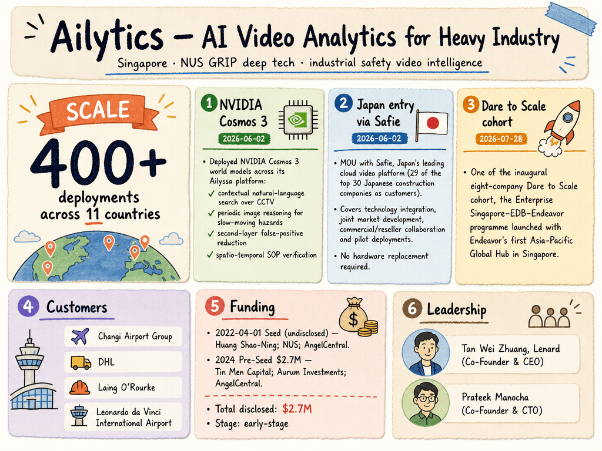

# Ailytics — LIVING BRIEF
_Last updated: 2026-11-03 00:25 UTC_

## Thesis
NUS GRIP-incubated Singapore computer-vision company selling industrial-safety AI that runs on the CCTV cameras sites already own. A US$7.4M Series A led by Tin Men Capital — with SG Growth Capital's SEEDS and Japanese partner Safie participating — buys local teams in the US, Japan, Australia and the Gulf, and the company says deployments have grown from 70 projects in four countries to more than 400 across 15. The open question is conversion: Ailytics discloses no revenue or ARR, and deployments are not the same thing as paying customers.

_Last material event: 2026-10-27 — Raised US$7.4M (S$9.4M) Series A led by Tin Men Capital, with SG Growth Capital's SEEDS and Safie participating_

## Profile
- Sector: AI / Deep tech
- Region: Singapore
- Stage / funding: Series A (2026); pre-Series A 2024; seed 2022
- Key people: Tan Wei Zhuang, Lenard (Co-Founder & CEO); Prateek Manocha (Co-Founder & CTO); Huang Shao-Ning (lead seed investor, early backer)

## Funding history
- **2022-04-01** — Seed, undisclosed — Huang Shao-Ning; National University of Singapore, AngelCentral — [ailytics.ai](https://ailytics.ai/ailytics-announces-seed-investment/)
- **2024** — Pre-Seed, $2.7M — Tin Men Capital; Aurum Investments, AngelCentral — [prnewswire.com](https://www.prnewswire.com/apac/news-releases/ailytics-raises-us2-7m-to-power-next-generation-scenario-based-ai-monitoring-for-heavy-industries-302105965.html)

_Total disclosed: $2.7M._

## Recent signals
- **2026-10-27** — Closed a US$7.4M (S$9.4M) Series A led by Tin Men Capital, with SG Growth Capital's SEEDS and Japanese camera maker Safie joining, to fund local teams in the US, Japan, Australia and the Gulf — [sbr.com.sg](https://sbr.com.sg/information-technology/news/ailytics-secures-9m-apac-us-and-gulf-expansion) (Also reported by: [apac.entrepreneur.com](https://apac.entrepreneur.com/business-news/singapores-ailytics-raises-7-4-mn-to-take-cctv-safety-ai-to-japan-the-us-and-the-gulf), [prnewswire.com](https://www.prnewswire.com/news-releases/tin-men-capital-leads-us7-4m-series-a-for-vision-ai-startup-ailytics-to-expand-across-apac-us-and-gulf-302918676.html), [backscoop.com](https://backscoop.com/startups/vision-ai-startup-ailytics-raises-7-4m-series-a-to-fuel-their-expansion))
  - Summary: Ailytics raised US$7.4M (S$9.4M) in a Series A led by Tin Men Capital, with SEEDS (the SG Growth Capital arm of Enterprise Singapore and EDB), Tokyo-listed cloud-camera company Safie, an unnamed large Japanese construction group, family offices and existing investors participating; valuation and stakes were not disclosed. The round is roughly 2.7x the US$2.7M pre-Series A of April 2024, also led by Tin Men, and follows growth from 70 projects in four countries to more than 400 deployments in 15. Proceeds fund expansion across Asia-Pacific, the US and the Gulf into manufacturing, logistics, oil and gas, maritime and mining, with local teams in the US, Japan, Australia and the Gulf; CEO Lenard Tan said Ailytics will target mid-sized US industrials that incumbents have priced out. Entrepreneur Asia Pacific cautions that projects and deployments are not necessarily paying customers, and that Ailytics has disclosed no revenue, ARR or profitability.
  - People: Lenard Tan (Co-Founder & CEO), Prateek Manocha (Co-Founder & CTO), Jeremy Tan (Managing Partner, Tin Men Capital)
  - Counterparties: Tin Men Capital (lead), SEEDS / SG Growth Capital, Safie, unnamed Japanese construction group; named customers: NatSteel, DHL, PaxOcean, Leonardo da Vinci International Airport, Changi Airport Terminal 5
  - Numbers: US$7.4M / S$9.4M Series A; ~2.7x the 2024 US$2.7M round; 400+ deployments in 15 countries (from 70 projects in 4); 5.7M+ hazards detected; 500M+ sq m monitored; 1,000+ cameras at Changi T5; client churn under 1% (Tin Men)
  - Quote: "The access to non-public data also enables the models to be sharper for these specific purposes, and all of this creates a truly defensible moat," — Jeremy Tan, Managing Partner, Tin Men Capital

## Older signals
- **2026-07-28** — Named to the inaugural eight-company Dare to Scale cohort, the Enterprise Singapore–EDB–Endeavor programme launched alongside Endeavor's first Asia-Pacific Global Hub in Singapore — [indiplomacy.com](https://indiplomacy.com/2026/07/28/enterprisesg-edb-and-endeavor-launch-asia-pacific-global-hub-to-support-startup-growth-in-singapore) (Also reported by: [enterprisesg.gov.sg](https://www.enterprisesg.gov.sg/resources/media-centre/news/2026/july/global-founder-network-endeavor-launches-singapore-hub-to-spark-multiplier-effect))
  - Summary: Enterprise Singapore, the Singapore Economic Development Board and Endeavor opened Endeavor's first Asia-Pacific Global Hub in Singapore at Jewel Changi Airport, alongside Dare to Scale, a new programme for high-potential early-stage startups expanding internationally. The inaugural cohort is eight Singapore-based companies — AIDX, Ailytics, Bluente, FailSafe Cybersecurity, HeyMax, Level3AI, Otonomi and ProfilePrint — spanning AI, fintech, agrifood technology and enterprise software. The programme provides access to international networks, mentorship and strategic introductions rather than capital, with EnterpriseSG recommending suitable startups into the network; the launch event drew more than 170 founders, investors and ecosystem partners. The EnterpriseSG account adds that the hub has no physical premises yet and that Ailytics, founded 2021 and already operating in more than 10 countries, is leaning on Endeavor member referrals for its US expansion.
  - People: Alvin Tan (Minister of State), Tan Wei Zhuang, Lenard (Co-Founder & CEO, Ailytics)
  - Counterparties: Enterprise Singapore, Singapore EDB, Endeavor (programme partners)
  - Numbers: 8 cohort companies; 170+ launch attendees; Ailytics operating in 10+ countries
- **2026-07-24** — Safie began full commercial rollout of the "Ailytics (SF)" unsafe-behaviour detection AI for construction and manufacturing sites, after confirming effectiveness in pilots with JR Kyushu and Obayashi — [safie.co.jp](https://safie.co.jp/news/4975)
  - Summary: Safie, Japan's largest cloud recording service by registered cameras (54.3% share, Techno Systems Research), said it has moved from its April 2026 strategic tie-up with Ailytics to full commercial provision of "Ailytics (SF)", which analyses Safie cloud-camera footage with Ailytics' AI to detect five unsafe behaviours: entry beneath suspended loads, entry into restricted areas, proximity to heavy machinery, missing safety equipment, and speeding. Trials ran 1 October–30 November 2025 at a JR Kyushu railway bridge construction site (61 days, 2 cameras, 2 licences) and 1 February–31 May 2026 at Obayashi's Sendai City Hall joint-venture site (120 days, 3 cameras, 3 licences). The product auto-clips the five seconds either side of a detection and reports through a per-site safety dashboard. Safie sells the product under its own brand as "Ailytics (SF)" with per-camera licences (the two pilots ran two and three licences respectively); the revenue split to Ailytics is not disclosed.
  - People: Tan Wei Zhuang (CEO, Ailytics); 佐渡島隆平 (President & CEO, Safie)
  - Counterparties: Safie (partner), JR Kyushu (pilot site), Obayashi (pilot site)
  - Numbers: 5 unsafe-behaviour categories; JR Kyushu trial 61 days / 2 cameras (Oct–Nov 2025); Obayashi trial 120 days / 3 cameras (Feb–May 2026); Safie 54.3% cloud-camera share
- **2026-06-10** — Posted a general news update (category: news) on its website — [Ailytics · news](https://cdn.prod.website-files.com/69649f66a99bea9a8e7b067c/6a1e86e8a804c20618a89ada_Untitled%20design%20(1)
- **2026-06-02** — Deployed NVIDIA Cosmos 3 world models into its Ailyssa platform, enabling spatio-temporal reasoning for industrial safety that was previously unsolvable with traditional CV — [Ailytics](https://www.ailytics.ai/news/industrial-video-intelligence-reimagined-ailytics-deploys-nvidia-cosmos-3-across-heavy-industry)
  - Summary: Ailytics integrated NVIDIA Cosmos 3 across four capabilities of its Ailyssa platform — contextual natural-language search across CCTV footage, periodic image reasoning for slow-moving hazards, second-layer false-positive reduction on generated alerts, and spatio-temporal SOP verification. The company positions this as a complement to its existing fast specialized models, not a replacement. Customers include Changi Airport Group, DHL, Laing O'Rourke, and Leonardo da Vinci International Airport.
  - People: Tan Wei Zhuang, Lenard (Co-Founder & CEO), Prateek Manocha (Co-Founder & CTO)
  - Counterparties: NVIDIA (Cosmos 3 model provider)
  - Numbers: 400+ deployments across 11 countries
  - Quote: "What Cosmos 3 adds is the ability to reason about a series of events within a view, across multiple views, and against a specific SOP. That is a genuinely new capability for CCTV-based safety in heavy industry, and our job is to make it work cost-effectively and accurately at scale." — Tan Wei Zhuang, Lenard, Co-Founder & CEO
- **2026-06-02** — Signed an MOU with Safie, Japan's leading cloud video platform (29 of top 30 Japanese construction companies as customers), to bring AI-powered industrial safety to Japan and beyond — [Ailytics](https://www.ailytics.ai/news/ailytics-and-safie)
  - Summary: Ailytics and Safie signed an MOU covering technology integration, joint market development in Japan, commercial/reseller collaboration, and pilot deployments. The partnership will start with safety management at construction and manufacturing sites, then expand to process and progress management. No hardware replacement is required as it works with existing camera infrastructure. The signing was witnessed by Enterprise Singapore and Tokyo Metropolitan Government officials.
  - People: Tan Wei Zhuang (CEO, Ailytics), Tetsuharu Furuta (Director & COO, Safie)
  - Counterparties: Safie (cloud video platform partner), Enterprise Singapore, Tokyo Metropolitan Government
  - Quote: "Japan is a market we deeply respect, with world-class industrial standards and a strong culture of safety, and Safie is exactly the right partner to help us earn trust there." — Tan Wei Zhuang, CEO, Ailytics
- **2026-05-20** — Partnered with Safie for market entry into Japan, extending its AI monitoring platform beyond Southeast Asia — [ailyitics.ai](https://www.ailytics.ai/news/winning-at-the-design-ai-and-tech-awards)
- **2026-05-20** — Won first place at the Supernova Challenge, an industry competition, validating its technology in a public forum — [ailyitics.ai](https://www.ailytics.ai/news/we-won-first-place-at-the-supernova-challenge)
- **2026-05-20** — Featured on The Business Times in April 2026, gaining mainstream business media coverage in Singapore — [ailyitics.ai](https://www.ailytics.ai/news/april-2026-business-times-feature)
- **2026-05-20** — Published its 2025 retrospective marking five years of operations, reflecting on growth and milestones achieved — [ailyitics.ai](https://www.ailytics.ai/news/turning-five-our-2025-retrospective)

## Open questions
- What valuation did the US$7.4M Series A set, and what stakes did Safie and the unnamed Japanese construction group take?
- What revenue does Ailytics book per Safie-branded deployment, and how much of total revenue does Japan now contribute?
- What share of the 400+ deployments are paid contracts rather than pilots, and does any ARR figure exist?
