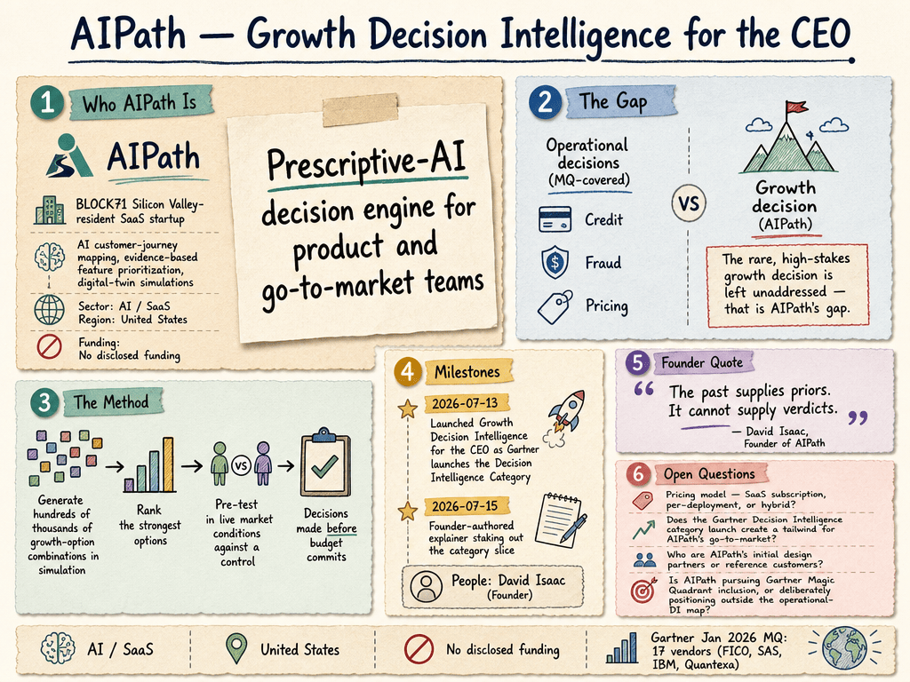

# AIPath — LIVING BRIEF
_Last updated: 2026-10-13 22:50 UTC_

## Thesis
AIPath is a BLOCK71 Silicon Valley-resident SaaS startup building a prescriptive-AI decision engine for product and go-to-market teams. The company applies AI customer-journey mapping, evidence-based feature prioritization, and digital-twin simulations to help CEOs make growth decisions, targeting the emerging Decision Intelligence category defined by Gartner.

_Last material event: 2026-07-13 — AIPath launched Growth Decision Intelligence for the CEO, timed with Gartner's Decision Intelligence category launch_

## Profile
- Sector: AI / SaaS
- Region: United States

## Funding history
_No disclosed funding._

## Recent signals
- **2026-09-18** — AIPath argued on an InnoLead panel that general-purpose AI platforms leave the CEO's growth-strategy decision uncovered, positioning its Growth Decision Intelligence tool as the missing specialised layer — [aipath.one](https://aipath.one/post/every-department-got-ai-business-tools)
  - Summary: In a founder-authored post, AIPath's David Isaac recapped an InnoLead LinkedIn Live held 17 September 2026 on whether specialised AI business tools still make sense once enterprises have bought general-purpose platforms such as Copilot or Claude. Isaac argued the gap is the CEO's growth-strategy decision: every department owns execution tools that start after the growth strategy already exists, while the person who funds them works off a slide and a spreadsheet. He said general assistants cannot supply state and action — they will not hold a ranking still between quarters or run a live market test — and pointed to the panel's shared conclusion that the enterprise stack will be both general and specialised, joined by an integration layer or protocol such as MCP.
  - People: David Isaac (Founder, AIPath), Scott Kirsner (host, InnoLead), Curtis Michelson (host, InnoLead), James Hantho (Aucctus)
  - Counterparties: InnoLead (panel host)
  - Numbers: panel held 2026-09-17; Aucctus research — 100+ interviews, 50% reported no measurable cycle-time improvement, 55% had no AI-impact metrics
  - Quote: "We've all got plenty of investments in data. We've got plenty of investments in execution tools. But the CEO pays for everybody else's tools, and doesn't actually have their own AI growth decision strategy tool." — David Isaac, Founder, AIPath
- **2026-09-17** — AIPath published a category-comparison post grading growth-strategy tools against five tests and scoring itself as the only category built for the CEO that both develops and pre-tests growth options, placing enterprise decision intelligence (FICO, SAS, Aera, Quantexa) and general AI assistants (ChatGPT, Claude, Copilot) one step short — [aipath.one](https://www.aipath.one/post/growth-strategy-tools-compared)
  - Summary: Founder David Isaac scored growth-strategy tooling on five tests — built for the CEO, prescribes rather than describes, continuous rather than episodic, develops the options, and pre-tests in market before the budget commits. AIPath passes all five; enterprise decision intelligence passes four but serves operations and data teams rather than the CEO; general AI assistants reach the CEO directly but hold no live model of the company and run no market test. OKR platforms (WorkBoard, Cascade, Perdoo), BI/CRM (Tableau, Amplitude, HubSpot), decision workflow (Cloverpop) and work management (Jira, Monday, Asana) are placed on the tracking side, and the post repeats that Gartner's January 2026 Decision Intelligence Platforms Magic Quadrant tests operations, not growth.
  - People: David Isaac (Founder, AIPath)
  - Numbers: 5 tests across 8 tool categories; 35 named tools; PwC 2016 Big Decisions survey — 13% of 2,100+ executives used prescriptive analytics
  - Quote: "The fear underneath most growth decisions is not choosing the wrong option. It is finding out later that the right one existed the whole time and nobody in the room thought of it." — David Isaac, Founder, AIPath

## Older signals
- **2026-09-13** — AIPath's founder states the company is deliberately not targeting Gartner's Decision Intelligence Platform Magic Quadrant, positioning "Growth Decision Intelligence for the CEO" as the growth-strategy layer above the 17 operational-risk vendors Gartner named in January 2026 — [aipath.one](https://www.aipath.one/post/what-growth-decision-intelligence-must-prove)
  - Summary: In a founder-authored post, David Isaac argues growth decision intelligence is a distinct field from the decision intelligence Gartner's January 2026 Magic Quadrant covers: the 17 evaluated platforms decide operational and risk questions such as fraud, credit, supply chain and pricing, while the growth decision — which segment, product, position and how much budget to point at each — is a separate, unaddressed parent decision. AIPath says it has been live in market since May 2024 on a method developed from 2023, that a tier-1 management consultancy runs AIPath itself, and that it is publishing the five capabilities it has not yet proved at scale.
  - People: David Isaac (Founder, AIPath)
  - Numbers: 17 vendors in Gartner's January 2026 Decision Intelligence Magic Quadrant; AIPath live in market since May 2024; observed acquisition cost fell from USD 240 to USD 43 over ten weeks for one financial-services customer; a telco CEO matched a 50-person team's 18-month output in 17 minutes
  - Quote: "A recommendation that arrives without the case against it is an opinion with a logo on it." — David Isaac, Founder, AIPath
- **2026-07-15** — AIPath published a founder-authored explainer staking out "Growth Decision Intelligence" as the strategic-decision slice of the category Gartner's January 2026 Decision Intelligence Magic Quadrant doesn't cover — [aipath.one](https://www.aipath.one/post/what-is-growth-decision-intelligence)
  - Summary: Founder David Isaac's post defines Growth Decision Intelligence as decision intelligence applied to the growth decision — which segments, positions, and initiatives a company funds next. It argues Gartner's inaugural January 2026 Magic Quadrant for Decision Intelligence Platforms (17 vendors, including FICO, SAS, IBM, Quantexa) covers only high-frequency operational decisions such as credit, fraud, and pricing, leaving the rare, high-stakes growth decision unaddressed. AIPath says it closes that gap by generating and ranking hundreds of thousands of growth-option combinations in simulation, then pre-testing the strongest in live market conditions against a control before budget commits; the post links a live demo at library.aipath.one/home and a free 45-minute working session.
  - People: David Isaac (Founder)
  - Quote: "The past supplies priors. It cannot supply verdicts." — David Isaac, Founder of AIPath
- **2026-07-13** — AIPath Launches Growth Decision Intelligence for the CEO as Gartner launches the Decision Intelligence Category — [markets.businessinsider.com](https://markets.businessinsider.com/news/stocks/aipath-launches-growth-decision-intelligence-for-the-ceo-as-gartner-launches-the-decision-intelligence-category-1036318213)
- **2026-07-02** — Tech in Asia features AIPath's AI-simulation approach to lowering customer acquisition cost — [techinasia.com](https://www.techinasia.com/lowering-customer-acquisition-cost-ai-simulation)

## Open questions
- What is AIPath's pricing model — SaaS subscription, per-deployment, or hybrid?
- Does the Gartner Decision Intelligence category launch create a tailwind for AIPath's go-to-market?
- Who are AIPath's initial design partners or reference customers?
- Has any independent source validated AIPath's self-graded five-test comparison against the 35 tools it names?
