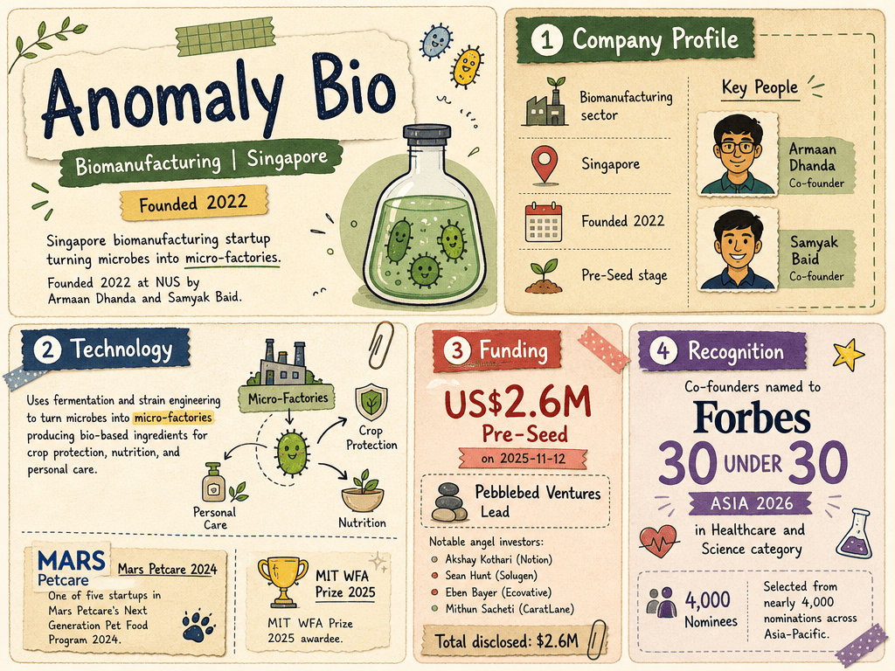

# Anomaly Bio — LIVING BRIEF
_Last updated: 2026-10-25 20:01 UTC_

## Thesis
The Hangar (NUS Enterprise)-resident biomanufacturing startup using fermentation and strain engineering to turn microbes into 'micro-factories' producing bio-based ingredients for crop protection, nutrition, and personal care. Founded in 2022 at NUS by Armaan Dhanda and Samyak Baid, the company was one of five startups in Mars Petcare's Next Generation Pet Food Program 2024 and an MIT WFA Prize 2025 awardee. The co-founders' own account on NUS's iDP podcast adds a paid Mars Petcare pilot to the previously public record of prizes and grants, and its first paid customer relationship now sits alongside the Ingredion/AAK/Bühler/Givaudan programme as evidence the ingredient platform is being bought rather than only awarded.

_Last material event: 2026-10-07 — Selected as one of five APAC startups for the Ingredion/AAK/Bühler/Givaudan Healthy Snacks Challenge 2027_

## Profile
- Sector: Biomanufacturing
- Region: Singapore
- Founded: 2022
- Stage / funding: Pre-Seed
- Key people: Armaan Dhanda (Co-founder), Samyak Baid (Co-founder)

## Funding history
- **2025-11-12** — Pre-Seed, US$2.6M — Pebblebed Ventures; Akshay Kothari (Notion), Sean Hunt (Solugen), Eben Bayer (Ecovative), Mithun Sacheti (CaratLane) — [technode.global](https://technode.global/2025/11/12/singapores-anomaly-bio-raises-2-6m-in-funding-led-by-pebblebed-ventures/)

_Total disclosed: $2.6M._

## Recent signals
- **2026-10-07** — Selected as one of five Asia-Pacific startups for the Ingredion/AAK/Bühler/Givaudan Healthy Snacks Challenge 2027, cited for whole-food protein–fibre ingredients from submerged fermentation — [ingredion.com](https://www.ingredion.com/apac/en-sg/news-events/news/ingr-healthy-snack-challenge-2027) (Also reported by: [foodtechbiz.com](https://www.foodtechbiz.com/business-updates/aak-bhler-givaudan-and-ingredion-announce-top-5-companies-selected-for-the-healthy-snacks-challenge-2027))
  - Summary: Ingredion, AAK, Bühler and Givaudan named Anomaly Bio one of five Asia-Pacific companies for the Healthy Snacks Challenge 2027, a programme to develop healthier, commercially viable snack solutions. Anomaly Bio was selected for whole-food protein–fibre ingredients made through submerged fermentation, with its Pruv® ingredient cited as supporting human nutrition across 9+ approved markets and its processing enabling ambient supply chains. The five companies work with the four partners from October to December 2026, then attend Snacks Hack Week in Singapore on 18–22 January 2027, which closes with a Finalists Demo Day on 22 January and a Top 3 Showcase carrying access to the partners' laboratories for further development; FoodTechBiz's 22 October account names the rest of the cohort as Agro Ludens (Japan), Coa & Co (Singapore), Protoga (China) and ROA Midnight (Singapore).
  - Counterparties: Ingredion, AAK, Bühler, Givaudan (programme partners)
  - Numbers: 5 companies selected; Snacks Hack Week 18–22 Jan 2027; Pruv® approved in 9+ markets
  - Quote: "The five selected companies reflect the creativity and technical potential emerging from the Asia-Pacific food innovation ecosystem." — Adrien Beauvisage, Head of Region Southeast Asia, Bühler Group

## Older signals
- **2026-08-27** — Selected for ProVeg Incubator's second Fast-track to Impact cohort, the Singapore entry among 15 fermentation, next-generation-fat and upcycled-ingredient startups — [proveg.org](https://proveg.org/press-release/15-high-impact-startups-selected-for-second-fast-track-to-impact-cohort-at-proveg-incubator)
  - Summary: ProVeg Incubator, which describes itself as the world's first and longest-running alternative-protein incubator, selected 15 startups from a global applicant pool spanning 11 countries and four continents; Anomaly Bio is listed under fermentation. The cohort entry states the company has raised US$2.6M in pre-seed funding led by Pebblebed and secured more than US$125,000 in grants, including the 2025 MIT Food, Water and Agriculture Innovation Prize — confirmation that no follow-on equity round has been announced since November 2025. Anomaly Bio engineers microbes into "micro-factories" that convert simple sugars into functional ingredients for nutrition and health, and is supported by strategic advisor Ingeborg Gasser-Kriss.
  - People: Armaan Dhanda (Co-founder), Samyak Baid (Co-founder)
  - Numbers: 15 startups selected; 11 countries; US$2.6M pre-seed; US$125,000+ in grants
- **2026-05-28** — Co-founders Samyak Baid and Armaan Dhanda named to Forbes 30 Under 30 Asia 2026 list in the Healthcare and Science category — [mustsharenews.com](https://mustsharenews.com/forbes-30-under-30-2026)
  - Summary: The Anomaly Bio co-founders were among 18 Singaporeans selected for Forbes 30 Under 30 Asia 2026. They were recognised in the Healthcare and Science category from nearly 4,000 nominations across Asia-Pacific.
  - People: Samyak Baid (Co-founder), Armaan Dhanda (Co-founder)
- **2026-05-08** — Co-founders told NUS's iDP podcast that Anomaly Bio has a paid pilot with Mars Petcare, alongside the US$2.6M pre-seed, the 2025 MIT Water, Food & Agriculture prize and a hackathon award from Prime Minister Lawrence Wong — [rss.com](https://rss.com/podcasts/intriguedtoinnovate/2805315)
  - Summary: In episode 11 of the NUS Innovation & Design Programme's "Intrigued to Innovate" podcast, host Dr Jovan Tan interviewed co-founders Armaan Dhanda and Samyak Baid, who began the company as a CDE3301 proof-of-concept named Pawsible converting food waste into alternative protein for pet nutrition. The episode notes state Anomaly Bio has secured a paid pilot with Mars Petcare, won the 2025 MIT Water, Food & Agriculture Innovation Prize, received a hackathon award from Singapore Prime Minister Lawrence Wong, and raised US$2.6M in pre-seed funding led by Pebblebed Ventures. The company is described as engineering microbes into micro-factories that convert sugar into bio-based ingredients for crop protection, nutrition and personal care, targeting more resilient ingredient supply chains.
  - People: Armaan Dhanda (Co-founder), Samyak Baid (Co-founder), Dr Jovan Tan (host, NUS Innovation & Design Programme)
  - Counterparties: Mars Petcare (paid pilot)
  - Numbers: US$2.6M pre-seed; paid pilot with Mars Petcare; both founders under 23 at recording

## Open questions
- What is the scale, term and application scope of the Mars Petcare paid pilot, and does it cover pet nutrition only or human-nutrition ingredient supply as well?
- What does the ProVeg Incubator programme provide beyond mentorship — funding, pilot facilities, or industry introductions — and does it take equity?
- The programme offers validation, lab access and a Top 3 showcase but no disclosed cash or offtake — what turns a Healthy Snacks Challenge placement into a commercial ingredient supply deal with AAK, Bühler, Givaudan or Ingredion?
