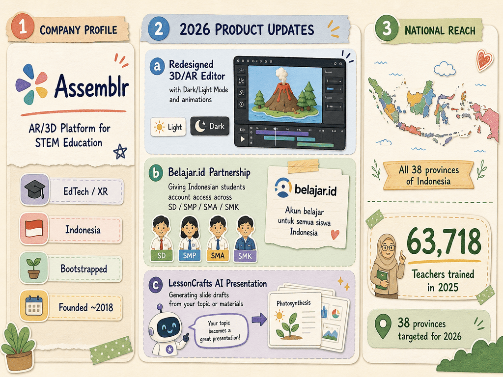

# Assemblr — LIVING BRIEF
_Last updated: 2026-10-14 22:00 UTC_

## Thesis
Assemblr is an Indonesian AR / 3D-content platform building the Assemblr EDU product for K-12 STEM education, with a growing teacher-training program across all 38 Indonesian provinces and a Kemendikdasmen partnership the company says reaches more than 16 million teachers and students. A US$400,000 Shariah-compliant investment from Malaysian VC Ficus Capital's SEA Fund into subsidiary Assemblr Studio Sdn Bhd funded its November 2025 entry into Malaysia — the company's first disclosed institutional money and its first market outside Indonesia. The 2026 return of its Roadshow Webinar, which engaged over 63,718 teachers in 2025, indicates sustained adoption of AR technology in Indonesia's education system.

_Last material event: 2026-08-11 — Assemblr EDU listed on Learning Cabinet, a global curated EdTech platform built on the UNICEF-led EdTech for Good Framework_

## Profile
- Sector: EdTech / XR
- Region: Indonesia (HQ Bandung), Singapore (CT HUB2, 336 Smith St)
- Founded: ~2018
- Stage / funding: Bootstrapped at parent level; Malaysian subsidiary Assemblr Studio Sdn Bhd funded by a US$400,000 Ficus SEA Fund investment (Nov 2025)
- Key people: Hasbi Asyadiq (Founder & CEO)
- Identifiers: [LinkedIn](https://www.linkedin.com/company/assemblr)

## Funding history
_No disclosed funding._

## Recent signals
- **2026-09-24** — ImajiNation 2026 closed registration with 6,800 student and educator participants, moving into national judging — [assemblrworld.com](https://www.assemblrworld.com/blog/imajination-2026-registration-and-project-submission-officially-closed-6800-students-and-educators-enter-the-judging-stage)
  - Summary: Assemblr EDU closed registration and project submission for ImajiNation 2026 — the national Visual Coding competition it runs with Indonesia's Kemendikdasmen and Samsung for Education — with 6,800 student and educator participants, short of the 11,000+ the launch announcement targeted. Submitted projects now enter national judging running 22 September to 22 October 2026, scored by a panel against category-specific criteria.
  - Numbers: 6,800 participants; judging 22 Sep–22 Oct 2026

## Older signals
- **2026-08-11** — Assemblr EDU added to Learning Cabinet, a curated global EdTech platform built on the EdTech for Good Framework (UNICEF, Finland's MFA, Arm, ADB), extending its 3D/AR distribution beyond Indonesia — [assemblrworld.com](https://www.assemblrworld.com/id/blog/assemblr-edu-kini-hadir-di-learning-cabinet-perluas-akses-pembelajaran-interaktif-berbasis-3d-ar-untuk-guru-dan-murid-di-seluruh-dunia) (Also reported by: [assemblrworld.com](https://www.assemblrworld.com/blog/assemblr-edu-now-available-on-learning-cabinet-expanding-access-to-interactive-3d-ar-learning-for-teachers-and-students-worldwide))
  - Summary: Assemblr EDU has officially joined Learning Cabinet, a curated platform for EdTech solutions that have demonstrated real learning impact and scale potential, developed on the EdTech for Good Framework assembled by UNICEF, Finland's Ministry for Foreign Affairs, Arm and the Asian Development Bank with global partners. The Indonesian-language announcement frames the listing as a step toward making 3D and AR learning accessible worldwide — complementing Assemblr's Kemendikdasmen partnership in Indonesia, which it says reaches more than 16 million teachers and students, and its offline platform version for schools with limited internet access. Learning Cabinet curators assess solutions for safe, high-quality, impactful use of education technology.
  - Counterparties: Learning Cabinet (distribution platform), Kemendikdasmen (Indonesian ministry partner)
  - Numbers: 16M+ teachers and students reached in Indonesia via Kemendikdasmen partnership
- **2026-08-03** — Assemblr EDU, Indonesia's education ministry (Kemendikdasmen), and Samsung for Education launch ImajiNation 2026, a national visual-coding competition targeting 11,000+ participants from 2,000+ schools across 38 provinces — [assemblrworld.com](https://www.assemblrworld.com/blog/imajination-2026-officially-launches-bringing-a-national-visual-coding-competition-to-students-and-teachers-across-38-provinces) (Also reported by: [techinasia.com](https://www.techinasia.com/indonesias-education-ministry-partners-assemblr-samsung-nationwide-visual-coding-championship), [infopublik.id](https://infopublik.id/kategori/nasional-sosial-budaya/983400/kemendikdasmen-dan-assemblr-edu-luncurkan-imajination-2026), [kemendikdasmen.go.id](https://www.kemendikdasmen.go.id/en/press-release/15926-kemendikdasmen-dan-assemblr-edu-luncurkan-imajination-2026-untuk-perkuat-pembelajaran-koding-dan-ai))
  - Summary: ImajiNation 2026 is a national digital creation championship co-launched by Kemendikdasmen, Assemblr EDU, and Samsung (through Samsung for Education), targeting more than 11,000 participants from over 2,000 schools across all 38 provinces. Students build projects using Visual Coding, 3D, and AR, aligned with Indonesia's new Coding and AI school subject and the Ministry's Deep Learning approach. Minister Abdul Mu'ti publicly endorsed the competition as part of the ministry's coding and AI learning agenda. A six-week national learning program precedes an in-person Grand Final in Jakarta in October 2026, including a live Junior High School Visual Coding Battle on the Samsung EDU Innovation Stage and an Education Expo (about 1,000 on-site visitors and 5,000 livestream viewers). The ministry's own release adds that it positions the competition inside its Rumah Pendidikan digital-learning platform, that there are three student pathways (elementary, junior high, senior high) plus one for teachers, and carries endorsements from Deputy Minister Atip Latipulhayat and the Minister's special staff for digital transformation and AI, Muchlas Rowi.
  - People: Abdul Mu'ti (Minister of Primary and Secondary Education), Atip Latipulhayat (Deputy Minister of Primary and Secondary Education), Hasbi Asyadiq (Co-Founder & CEO, Assemblr), Ian Chong (Head of Mobile Enterprise & Education, Samsung SEA & Oceania)
  - Counterparties: Kemendikdasmen (partner); Samsung for Education (supporter)
  - Numbers: 11,000+ participants; 2,000+ schools; 38 provinces; ~1,000 on-site / ~5,000 livestream at Education Expo
  - Quote: "Our goal is not simply to teach students how to write code, but to nurture systematic, creative, collaborative, and problem-solving ways of thinking." — Abdul Mu'ti, Minister of Primary and Secondary Education
- **2026-06-29** — Assemblr 2026 Updates: New Editor, Belajar.id & AI Presentation — [assemblrworld.com](https://www.assemblrworld.com/es/blog/latest-assemblr-updates-new-editor-belajar-id-and-lessoncrafts)
  - Summary: Assemblr redesigned its 3D/AR editor with Dark Mode/Light Mode, animations, visual coding templates, and real-time collaboration. Assemblr EDU expanded exclusive access to students with Belajar.id accounts across Indonesia (SD/SMP/SMA/SMK domains). LessonCrafts launched an AI Presentation feature generating editable slide drafts from a lesson topic, with a new Competition Page aggregating all monthly Assemblr EDU contests.
- **2026-04-13** — Assemblr EDU Roadshow Webinar returns for 2026, targeting teachers across all 38 Indonesian provinces to enhance AR-based teaching skills — [Assemblr Blog](https://www.assemblrworld.com/blog/assemblre-edus-roadshow-webinar-returns-in-2026-to-enhance-teachers-skills-with-ar-technology)
- **2025-11-12** — Ficus Capital put US$400,000 from its Ficus SEA Fund into Assemblr's Malaysian subsidiary Assemblr Studio Sdn Bhd, funding the company's first market outside Indonesia — [asiaeducationreview.com](https://www.asiaeducationreview.com/others/news/assemblr-edu-expands-to-malaysia-boosts-education-in-indonesia-nwid-5041.html)
  - Summary: Asia Education Review reported that Assemblr is entering Malaysia on the back of a US$400,000 Shariah-compliant investment from Malaysian venture firm Ficus Capital through its Ficus SEA Fund — Ficus Capital's first cross-border deal. The funding went to Assemblr Studio Sdn Bhd, the Malaysian subsidiary that will replicate the Indonesian immersive-education model; CEO Hasbi Asyadiq said it would serve as a hub for collaboration with Malaysian educators, ministries and educational organisations. The same piece recaps Assemblr EDU's Kemendikdasmen partnership announced at the ministry's inaugural CDT Talks, where teachers holding official @guru and @pendidik accounts get premium access to the 3D object library, AR teaching aids, experience builders and 3D editors, an initiative the ministry expects to benefit more than 16 million users.
  - People: Hasbi Asyadiq (Founder & CEO, Assemblr), Yudistra Nugraha (Head of Pusdatin, Kemendikdasmen), Prof. Nunuk Suryani (Director General of Teachers and Education Personnel)
  - Counterparties: Ficus Capital (investor), Kemendikdasmen / Pusdatin (ministry partner)
  - Numbers: US$400,000 investment; 16M+ expected users; Ficus Capital's first cross-border deal
  - Quote: "Assemblr was built on the idea to make education more engaging and accessible to anyone. Expanding into Malaysia is a proud milestone as we continue our journey to become a global platform that empowers educators and students through immersive learning" — Hasbi Asyadiq, Founder and CEO, Assemblr
- **2025-05-05** — Assemblr EDU announced as an official Belajar.id partner platform at Kemendikdasmen's CDT Talks #1 seminar, joining Canva and Quizizz among the ministry's national platform partners — [assemblrworld.com](https://www.assemblrworld.com/blog/meet-assemblr-edu-the-first-official-partner-platform-of-belajar-id-from-indonesia)
  - Summary: Kemendikdasmen's CDT Talks #1 seminar (April 30, 2025) marked the official launch of the ministry's collaboration with Assemblr EDU, adding the 3D/AR platform to Belajar.id's partner list alongside Canva and Quizizz. Assemblr EDU (founded 2020) provides 3D/AR teaching aids, ready-to-use topics, and a drag-and-drop editor for teachers and students.
  - People: Hasbi Asyadiq (CEO & Founder, Assemblr EDU)
  - Counterparties: Kemendikdasmen (partner)

## Open questions
- Is Assemblr generating meaningful revenue from its EDU product, or is growth primarily grant- and partnership-driven?
- Is LessonCrafts generating stand-alone revenue, or is it bundled into Assemblr EDU subscriptions?
- What is the Malaysian go-to-market — a ministry-level partnership on the Indonesian model — and does the Ficus Capital investment sit at subsidiary or group level?
