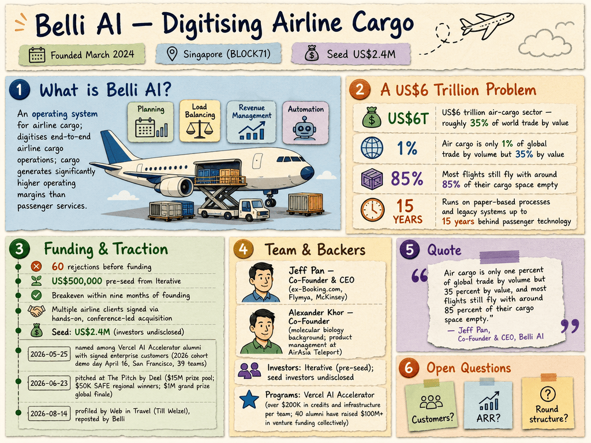

# Belli AI — LIVING BRIEF
_Last updated: 2026-10-14 22:00 UTC_

## Thesis
Belli AI is a BLOCK71 Singapore-resident air-cargo software startup founded by veterans of McKinsey, SpaceX, Boeing, Booking.com, and AirAsia, digitising end-to-end airline cargo operations. The company has raised a US$2.4M seed round and been selected for the Vercel AI Accelerator program. Its inclusion as a named alumni with signed enterprise customers signals product-market validation and growing traction in the air-cargo digitisation space. Two October/September releases — a charter module covering quotation through billing and a booking-platform overhaul it says cut median booking time 47% — show the product widening from core cargo workflows into adjacent revenue lines, though both are self-reported on Belli's own news page with no independent coverage.

_Last material event: 2026-10-09 — Launched the Charter module, running a charter request from inbox through quotation, contract and billing inside its cargo system_

## Profile
- Sector: Logistics
- Region: Singapore
- Stage / funding: Seed (US$2.4M)
- Founders: ex-McKinsey, SpaceX, Boeing, Booking.com, AirAsia

## Funding history
- **2024-01-01** — Seed, US$2.4M — investors undisclosed — [block71.co](https://block71.co/directory/startups/belli-ai/)

_Total disclosed: $2.4M._

## Recent signals
- **2026-10-09** — Launched a charter module that takes a charter request from a shared inbox through quotation, approval, contract and billing in one flow, connecting to the airline's existing cargo management system rather than replacing it — [belli.ai](https://belli.ai/company/news/charter-quotation)
  - Summary: Belli's charter module replaces the email-and-spreadsheet charter desk. The request is picked up from the inbox, priced and approved in one place, and the accepted quote becomes a charter contract — ad hoc or programme — holding everything the price depends on: a lump sum split across air waybills by weight, all-in or surcharge pricing, rotation legs, fuel-index pricing, and cancellation and payment terms. Booking and invoice then follow from the contract without retyping, and every request is tracked from the first email so airlines can see how many enquiries became flights. Belli says the module connects to existing cargo management systems including iCargo, with setup typically taking one to two months on a flat monthly fee and no per-user licences.
  - Counterparties: iCargo / airline cargo management systems (integration)
  - Numbers: setup 1–2 months; flat monthly fee; no per-user licences
- **2026-09-23** — Reported a 47% like-for-like cut in median booking-creation time after completing rollout of its enhanced booking platform, from a 4.5-minute August baseline to 1.6 minutes — [belli.ai](https://belli.ai/company/news/belli-data-analytics-cut-airline-booking-times-by-47)
  - Summary: Following complete rollout of its enhanced booking platform, Belli's own performance analysis found median booking-creation time down 47% like-for-like, from an August baseline of 4.5 minutes to 1.6 minutes; a charted early baseline was 4.90 minutes on 19 August. The gains came from instrumenting the workflow: wallet configuration moved into the duplicate wizard, currency-mismatch validation surfaces at step 2, local autosave recovers an agent's place after a refresh, submission requests were made idempotent so retries cannot duplicate bookings, multi-leg interline leg handling was corrected, and wizard states that trapped agents mid-flow were removed. Belli says the optimisations save agents up to 20 minutes daily and that route- and session-level tracking now supports true like-for-like comparison between releases.
  - Numbers: 4.5 min → 1.6 min median booking time (47%); 4.90 min baseline on 19 Aug 2026; up to 20 min saved per agent per day
- **2026-09-22** — Co-founders Jeff Pan and Alex Khor presented "Building an AI Operating System for Cargo" at a Jakarta AI meetup hosted with OCBC, detailing a forward-deployed, ontology-first deployment model and naming Etihad, Emirates and the Lion Air Group as airlines whose operations Belli works inside — [belli.ai](https://belli.ai/company/news/belli-jakarta-ai-meetup)
  - Summary: Belli recapped its 6 June 2026 Jakarta meetup with OCBC, supported by Vercel and Singapore Global Network, where co-founders Jeff Pan and Alex Khor walked through how the company builds an AI operating system for air cargo. Khor described a plain-markdown cargo knowledge base written once and reused both to onboard new engineers and as direct context for Belli's AI agents; Pan framed unglamorous infrastructure work as the precondition for later speed. Belli's engineers deploy on-site with airlines including Etihad, Emirates and the Lion Air Group, spending the first days of each engagement mapping every point where data leaks into a spreadsheet or a single person's memory before writing code.
  - People: Jeff Pan (Co-Founder & CEO), Alex Khor (Co-Founder)
  - Counterparties: OCBC (meetup host), Vercel (supporter), Singapore Global Network (supporter)
  - Numbers: meetup held 2026-06-06 in Jakarta

## Older signals
- **2026-09-11** — Belli was crowned champion of the 2026 SWC Asia Finale and will represent Asia at the San Francisco Grand Finale in November, competing for a US$1M investment prize — [belli.ai](https://belli.ai/company/news/belli-crowned-champion-at-the-2026-swc-asia-finale)
  - Summary: Belli took the top spot at the 2026 SWC Asia Finale, where it was judged on its enterprise-grade SaaS for aviation cargo and its commercial scalability. As regional champion the team travels to San Francisco in November 2026 for the SWC Grand Finale and a US$1,000,000 investment prize; DPBIO Technology Limited and Set Sail AI were named first and second runner-up respectively.
  - Numbers: US$1,000,000 Grand Finale investment prize; November 2026 Grand Finale
- **2026-08-14** — Web in Travel profile (reposted by Belli) details the company's March 2024 founding, the US$500K Iterative pre-seed secured after 60 investor rejections, and breakeven within nine months with multiple airline clients — [belli.ai](https://www.belli.ai/news/read-what-web-in-travel-wit-wrote-about-belli-from-early-challenges-to-building-product-to-the-air-cargo-market)
  - Summary: A Web in Travel profile (by Till Welzel, reposted on Belli's news page) recounts the company's early path: Belli AI was founded in March 2024 by Jeff Pan (ex-Booking.com, Flymya, McKinsey) and Alexander Khor (molecular biology background; product management at AirAsia Teleport) to attack a US$6 trillion air-cargo sector — roughly 35% of world trade by value — that still runs on paper-based processes and legacy systems up to 15 years behind passenger technology. Pan and Khor faced 60 investor rejections before securing US$500,000 in pre-seed funding from Iterative, and reached breakeven within nine months of founding while signing multiple airline clients through hands-on, conference-led acquisition. Belli's software functions as an operating system for cargo spanning planning, load balancing, revenue management and automation; the profile notes cargo generates significantly higher operating margins than passenger services.
  - People: Jeff Pan (Co-Founder & CEO), Alexander Khor (Co-Founder)
  - Counterparties: Iterative (pre-seed investor)
  - Numbers: US$500K pre-seed (Iterative); 60 investor rejections; breakeven within 9 months; multiple airline clients; US$6T annual goods value; ~35% of world trade by value
- **2026-06-23** — Belli takes the stage at The Pitch by Deel — [belli.ai](https://www.belli.ai/blog)
  - Summary: Belli AI was selected to pitch at The Pitch by Deel, a global startup tournament by Deel with a $15M prize pool. Co-founder and CEO Jeff Pan and Associate Product Engineer Asael Jalocha presented Belli's airline cargo software in separate editions of the competition.
  - People: Jeff Pan (Co-founder & CEO), Asael Jalocha (Associate Product Engineer)
  - Numbers: $15M prize pool from Deel; $50K SAFE for regional winners; $1M grand prize for global finale; air cargo carries 35% of global trade value with ~85% empty cargo space
  - Quote: "Air cargo is only one percent of global trade by volume but 35 percent by value, and most flights still fly with around 85 percent of their cargo space empty." — Jeff Pan, CEO
- **2026-05-25** — Named as alumni with signed enterprise customers in Vercel's 2026 AI Accelerator recap — [Vercel Blog](https://vercel.com/blog/2026-vercel-ai-accelerator-recap)
  - Summary: Belli AI was highlighted among past Vercel AI Accelerator alumni that have signed enterprise customers and formed partnerships through the program. The 2026 cohort demo day was held April 16 at Vercel's San Francisco HQ with 39 teams presenting.
  - Numbers: Over $200K in credits and infrastructure per team; 40 alumni have raised $100M+ in venture funding collectively

## Open questions
- What is the deployment scale at Belli's named airlines (Etihad, Emirates, Lion Air Group) — pilot or production, and how many carriers are live?
- What is the specific revenue or ARR trajectory after the Vercel Accelerator program?
- Both product releases are on Belli's own news page with no independent coverage or customer case study — are the charter module and the 47% booking-time gain live at named airlines, and what does the flat monthly fee cost?
- What is the cash value and structure of the 2026 SWC Asia Finale win, and would a Grand Finale US$1M prize arrive as equity investment or a grant?
