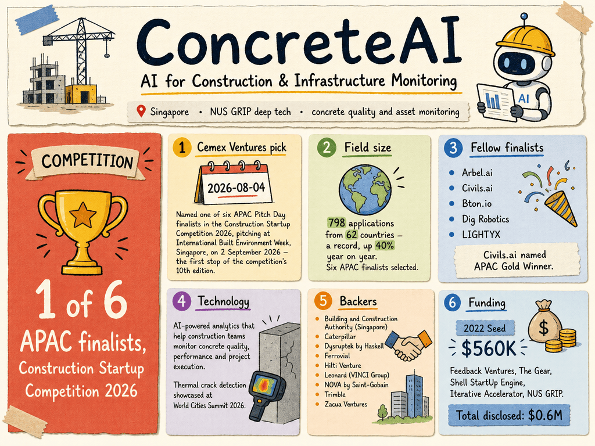

# ConcreteAI — LIVING BRIEF
_Last updated: 2026-11-01 21:16 UTC_

## Thesis
ConcreteAI is an NUS GRIP-incubated Singapore deep-tech startup whose IoT sensors and analytics track in-situ concrete strength and temperature in real time, replacing century-old cube testing on construction sites. Tech in Asia's October profile puts it at 60+ projects across Singapore, Malaysia, Australia and Bahrain, with LTA, Changi Airport Group and CDL among its clients — a commercial footprint well beyond what its 2022 seed round funded — and says the company plans its next raise for 2027.

_Last material event: 2026-08-04 — Selected as an APAC Pitch Day finalist in the Construction Startup Competition 2026_

## Profile
- Sector: Deep tech / IoT
- Region: Singapore

## Funding history
- **2022** — Seed, $560K — Feedback Ventures, The Gear, Shell StartUp Engine, Iterative Accelerator, NUS GRIP — [cbinsights.com](https://www.cbinsights.com/company/concreteai)

_Total disclosed: $0.6M._

## Recent signals
- **2026-10-09** — Tech in Asia coverage of ConcreteAI's IoT approach to replacing century-old concrete cube testing, putting the company at 60+ projects across four markets with LTA, Changi Airport Group and CDL among its clients — [techinasia.com](https://www.techinasia.com/replacing-centuryold-concrete-tests-iot)
  - Summary: Tech in Asia profiled ConcreteAI's sensor-plus-analytics system, which tracks in-situ concrete strength and temperature in real time instead of relying on lab cube tests. The article reports 60+ projects across Singapore, Malaysia, Australia and Bahrain, names LTA, Changi Airport Group and CDL among the clients, and puts cumulative funding at S$1.5M with the next round planned for 2027. That settles the deployment question left open by earlier signals: the technology is in commercial use on named projects, not still in pilot phase.
  - Counterparties: LTA, Changi Airport Group, CDL (clients)
  - Numbers: 60+ projects across 4 markets; S$1.5M raised to date per the article — above the US$560K seed recorded in Funding history; next round planned for 2027

## Older signals
- **2026-08-04** — Named one of the five APAC Pitch Day finalists in the Construction Startup Competition 2026, pitching at IBEW Singapore on 2 September 2026 — [cemexventures.com](https://www.cemexventures.com/startup-competition-2026-apac-finalists) (Also reported by: [bca.gov.sg](https://www1.bca.gov.sg/resources/newsroom/winner-of-the-inaugural-asia-pacific-edition-of-the-world-s-largest-competition-for-construction-start-ups), [intelligentbuild.tech](https://intelligentbuild.tech/2026/08/18/construction-startup-competition-2026-apac-pitch-day-finalists-announced), [cde.nus.edu.sg](https://cde.nus.edu.sg/deans-message-092026-industry-innovation))
  - Summary: Cemex Ventures selected six startups from a record 798 applications across 62 countries to pitch at the APAC Pitch Day on 2 September 2026 during International Built Environment Week in Singapore — the first stop of the competition's 10th edition. ConcreteAI was chosen for AI-powered analytics that help construction teams monitor concrete quality, performance and project execution, alongside Arbel.ai, Civils.ai, Bton.io, Dig Robotics and LIGHTYX. The APAC Pitch Day is backed by the Building and Construction Authority (Singapore), Caterpillar, Dysruptek by Haskell, Ferrovial, Hilti Venture, Leonard (VINCI Group), NOVA by Saint-Gobain, Trimble and Zacua Ventures. A 3 September post on the same site names fellow finalist Civils.ai as the APAC Gold Winner. BCA, the competition's APAC partner, records the same 2 September Pitch Day as five APAC Track winners pitching — Arbel.ai, Civils.ai, ConcreteAI, Bton.io and LIGHTYX — chosen from 243 APAC applications out of nearly 800 submissions from 64 countries (Dig Robotics appears on Cemex Ventures' list but not BCA's), and describes ConcreteAI's entry as IoT sensors tracking in-situ concrete strength and temperature in real time, cutting casting-cycle waiting times by over 30% and reducing reliance on cube testing. NUS College of Design and Engineering's September 2026 dean's message covers the same Pitch Day at the ConTech Summit and adds the founders behind the pitch — Chang Qingyang, Xi Yi Ooi, Isaac Siow and Yun Han Lim, all 2021 NUS graduates — and the company's origin as a 2021 CDE4301A Ideas to Startup final-year project.
  - People: Chang Qingyang (co-founder), Xi Yi Ooi (co-founder), Isaac Siow (co-founder), Yun Han Lim (co-founder)
  - Counterparties: Cemex Ventures (organiser); Building and Construction Authority (Singapore), Caterpillar, Ferrovial, Hilti Venture, Trimble, Zacua Ventures (competition partners)
  - Numbers: 6 APAC finalists (Cemex Ventures) / 5 APAC Track winners (BCA); 243 APAC applicants; ~800 submissions from 64 countries; casting-cycle waiting time cut over 30%; €10,000 Gold prize
  - Quote: "Our pitch focused on providing real-time concrete performance insights to construction sites to improve productivity, quality and sustainability." — Qingyang Chang, co-founder, ConcreteAI
- **2026-06-23** — ConcreteAI at World Cities Summit 2026 in Singapore — [linkedin.com](https://www.linkedin.com/posts/concreteai_worldcitiessummit-concreteai-thermalcrack-activity-7471120375322664960-VTSa)

## Open questions
- What specific product or solution did ConcreteAI showcase at World Cities Summit 2026?
- Did ConcreteAI convert the APAC Pitch Day (2 September 2026) into pilot or commercial discussions with the competition's corporate partners?
- ConcreteAI says it will strengthen its Singapore base and explore other regions — which markets first, and through partners or direct sales?
- What accounts for the gap between the S$1.5M raised that Tech in Asia reports and the US$560K seed in the funding record — undisclosed rounds, grants, or a different measure?
