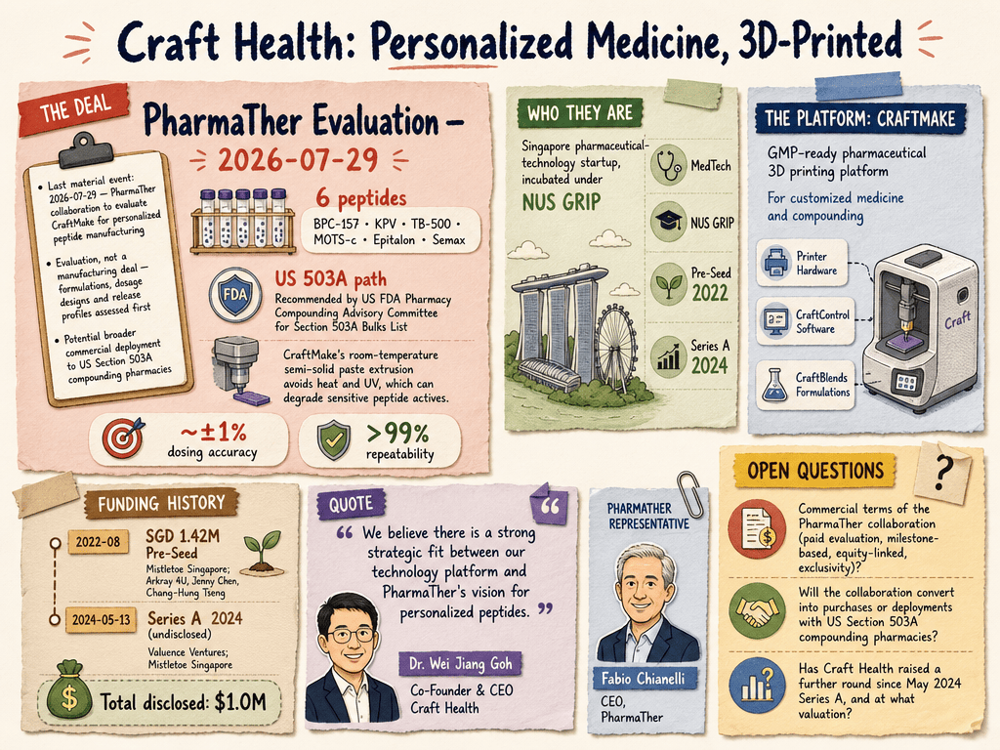

# Craft Health — LIVING BRIEF
_Last updated: 2026-10-21 23:38 UTC_

## Thesis
Craft Health is a Singapore pharmaceutical-technology startup, incubated under NUS GRIP, building CraftMake — a GMP-ready pharmaceutical 3D printing platform combining printer hardware, CraftControl software and CraftBlends printable formulations for customized medicine and compounding. Canadian specialty-pharma company PharmaTher (CSE: PHRM) is now its exclusive North American distributor: after agreeing in July 2026 to evaluate CraftMake for personalized peptides under its PERSONALIZ3D initiative, PharmaTher signed a distribution agreement in October 2026 covering CraftMake printers, CraftControl software, CraftBlends formulations, consumables and service across 503A/503B compounding pharmacies, telehealth, CDMOs, hospitals, academia, government and pharma/biotech customers — moving the platform from lab-scale validation toward commercial deployment in the US and Canada.

_Last material event: 2026-10-01 — PharmaTher signs exclusive North American distribution agreement for the CraftMake platform_

## Profile
- Sector: MedTech
- Region: Singapore
- Stage / funding: Pre-Seed (2022); Series A (2024)

## Funding history
- **2022-08** — Pre-Seed, SGD 1.42M — Mistletoe Singapore; Arkray 4U, Jenny Chen, Chang-Hung Tseng — [3dprint.com](https://3dprint.com/293411/3d-printed-pharma-firm-craft-health-receives-1m-from-investors-including-jenny-chen/)
- **2024-05-13** — Series A, undisclosed — Valuence Ventures; Mistletoe Singapore — [namic.sg](https://namic.sg/news/craft-health-secures-pre-series-a2-funding-to-revolutionize-compounding-pharmacy-with-3d-printing-technology/)

_Total disclosed: $1.0M._

## Recent signals
- **2026-10-01** — PharmaTher (CSE: PHRM) signed an exclusive North American distribution agreement for CraftMake, opening the US and Canadian markets across all customer segments, and now targets up to 50 CraftMake placements within 12 months — [newsfilecorp.com](https://www.newsfilecorp.com/release/316740/PharmaTher-Enters-into-Exclusive-North-American-Distribution-Agreement-with-Craft-Heal) (Also reported by: [pharmather.com](https://www.pharmather.com/invest/pharmather-enters-into-exclusive-north-american-distribution-agreement-with-craft-health-for-craftmaketm-pharmaceutical-3d-printing-platform), [pharmather.com (investor deck)](https://cdn.prod.website-files.com/6ac192dfbb747b629b4e889b/6ac2f310cd2ff6284316eeee_Deck%20-%20PHRM%20-%201020201.pdf))
  - Summary: PharmaTher Holdings became the exclusive North American distributor of Craft Health's CraftMake 3D printers, CraftControl software, CraftBlends printable formulations, consumables and service, covering compounding pharmacies (503A and 503B), telehealth and digital-health companies, CDMOs, hospitals, academic and government institutions, and pharma/biotech customers. The agreement builds on the July 2026 collaboration to evaluate CraftMake for personalized peptides and underpins PharmaTher's PERSONALIZ3D platform. PharmaTher plans initial CraftMake platform orders in Q4 2026 and estimates more than 10,000 potential placement sites in North America, each designed to generate recurring revenue. PharmaTher's 4 October investor presentation sharpens the rollout target to up to 50 CraftMake placements within 12 months, states that CraftMake is already sold and operating in multiple markets, and names PD Labs — a US national 503A compounding pharmacy with 26+ years of experience, made PharmaTher's Center of Excellence in August 2026 — as the site of the first CraftMake placement.
  - People: Fabio Chianelli (CEO, PharmaTher)
  - Counterparties: PharmaTher Holdings (exclusive North American distributor), PD Labs (US Center of Excellence; hosts the first CraftMake placement)
  - Numbers: 10,000+ potential North American placement sites; up to 50 CraftMake placements targeted in 12 months; ~7,500 US 503A pharmacies; ±1% dosing accuracy; first CraftMake orders Q4 2026; 8 dosage forms across 4 release profiles

## Older signals
- **2026-07-29** — PharmaTher (CSE: PHRM) signs collaboration to evaluate Craft Health's CraftMake 3D-printing platform for personalized peptide doses, with a path toward US compounding-pharmacy deployment — [newsfilecorp.com](https://www.newsfilecorp.com/release/307086/PharmaTher-Collaborates-with-Craft-Health-to-Evaluate-CraftMakeTM-GMPReady-Pharmaceutical-3D-Printing-Platform-for-Personalized-Peptides) (Also reported by: [3dprintingindustry.com](https://3dprintingindustry.com/news/craft-healths-craftmake-platform-gets-a-peptide-test-run-253591/), [investingnews.com](https://investingnews.com/pharmather-collaborates-with-craft-health-to-evaluate-craftmake-gmp-ready-pharmaceutical-3d-printing-platform-for-personalized-peptides), [biospace.com](https://www.biospace.com/press-releases/pharmather-collaborates-with-craft-health-to-evaluate-craftmaketm-gmp-ready-pharmaceutical-3d-printing-platform-for-personalized-peptides))
  - Summary: PharmaTher will evaluate CraftMake — Craft Health's GMP-ready pharmaceutical 3D printer, CraftControl workflow software and CraftBlends formulations — for producing personalized peptide doses, combination formulations, controlled-release designs and differentiated dosage forms under PharmaTher's Personaliz3D Peptides initiative. The evaluation targets six peptides (BPC-157, KPV, TB-500, MOTS-c, Epitalon, Semax) recently recommended by the US FDA's Pharmacy Compounding Advisory Committee for the Section 503A Bulks List. PharmaTher also intends to explore a broader commercial relationship to deploy CraftMake with qualified US Section 503A compounding pharmacies. 3D Printing Industry's August 7 report adds that PharmaTher launched the Personaliz3D Peptides division on July 27 with a three-part Connect, Personalize and Deliver plan (a telemedicine platform at PersonalizedPeptidesRx.com, 3D printing and AI formulation tools, and 503A pharmacy partnerships); the current agreement is an evaluation, not a manufacturing deal, with formulations, dosage designs and release profiles assessed before either side commits further. CraftMake's room-temperature semi-solid paste extrusion avoids heat and UV, which can degrade sensitive peptide actives. On the 503A question, the Investing News Network's 29 July reprint of the release confirms the deployment path is still stated as intent, not a commitment: PharmaTher "intends to explore a broader commercial relationship with Craft Health that could support the deployment of CraftMake™ with qualified Section 503A compounding pharmacies" — no purchases, volumes or pharmacy commitments are disclosed. BioSpace's reprint of the same Newsfile release likewise carries no financial terms and no exclusivity for peptides — answering the commercial-terms question with "undisclosed".
  - People: Dr. Wei Jiang Goh (Co-Founder & CEO, Craft Health), Fabio Chianelli (CEO, PharmaTher)
  - Counterparties: PharmaTher Holdings (partner)
  - Numbers: 6 peptides under evaluation; ~±1% dosing accuracy; >99% repeatability
  - Quote: "We believe there is a strong strategic fit between our technology platform and PharmaTher's vision for personalized peptides." — Dr. Wei Jiang Goh, Co-Founder & CEO, Craft Health

## Open questions
- Has Craft Health raised a further round since its May 2024 Series A, and at what valuation?
- What revenue-sharing or margin terms govern PharmaTher's exclusive North American CraftMake distribution agreement?
