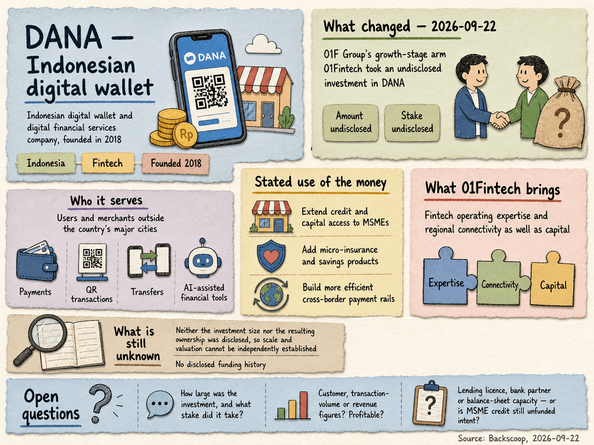

# Dana — LIVING BRIEF
_Last updated: 2026-11-03 00:25 UTC_

## Thesis
DANA is an Indonesian digital wallet and digital-financial-services company, founded in 2018 and built to reach users and merchants outside the country's major cities with payments, QR transactions, transfers and AI-assisted financial tools in one app. In September 2026, 01F Group's growth-stage arm 01Fintech took an undisclosed investment, with the stated intent of extending credit and capital access to MSMEs, adding micro-insurance and savings products, and building more efficient cross-border payment rails. Neither the investment size nor the resulting ownership was disclosed, so the company's scale and valuation cannot be independently established.

_Last material event: 2026-09-22 — 01F Group, through its 01Fintech growth-stage arm, took an undisclosed investment in DANA_

## Profile
- Sector: Fintech
- Region: Indonesia
- Founded: 2018
- Stage / funding: Growth stage; 01F Group (01Fintech) investment September 2026, size undisclosed

## Funding history
_No disclosed funding._

## Recent signals
_none_

## Older signals
- **2026-09-22** — Took an undisclosed growth investment from 01F Group's 01Fintech arm, earmarked for MSME credit, micro-insurance and cross-border payments — [backscoop.com](https://backscoop.com/startups/global-investment-platform-01f-group-invests-in-indonesias-dana)
  - Summary: Backscoop reported that 01F Group invested in DANA through 01Fintech, its growth-stage fintech private-equity arm, without disclosing the amount. The stated plans are to expand credit and capital access for Indonesian MSMEs, widen access to micro-insurance, digital savings and wealth-building tools for underserved users, and explore more efficient cross-border payment options for Indonesian merchants and users. 01Fintech is to contribute fintech operating expertise and regional connectivity as well as capital.
  - Counterparties: 01F Group / 01Fintech (investor)

## Open questions
- How large was 01F Group's investment, and what stake did it take?
- What customer, transaction-volume or revenue figures does DANA report, and is it profitable?
- Does the 01Fintech tie-up bring a lending licence, a bank partner or balance-sheet capacity, or is the MSME credit plan still unfunded intent?
