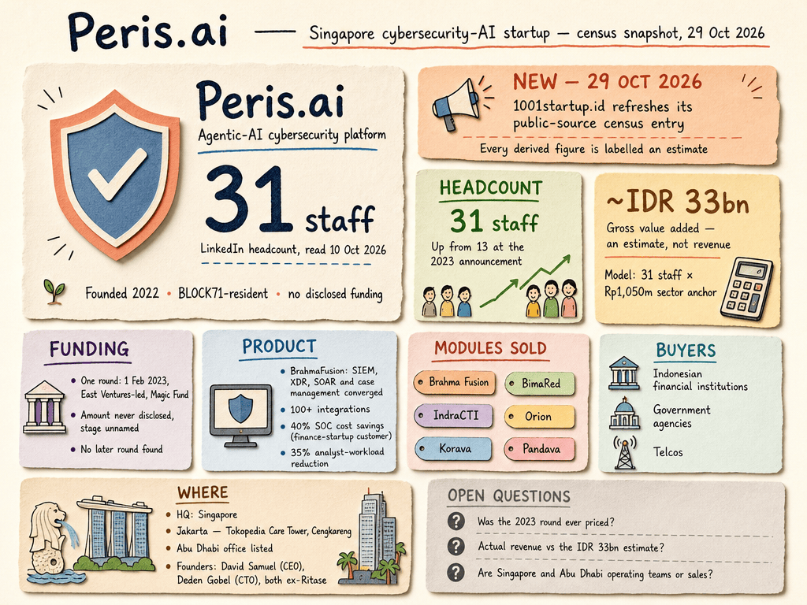

# Peris.ai — LIVING BRIEF
_Last updated: 2026-10-31 20:38 UTC_

## Thesis
Peris.ai is a Singapore-based cybersecurity-AI startup (BLOCK71-resident) building an Agentic-AI cybersecurity platform for autonomous threat detection, hyperautomation, and incident response across the attack surface.

_Last material event: none on record_

## Profile
- Sector: Cybersecurity / AI
- Region: Singapore and Indonesia — LinkedIn lists Singapore as headquarters and peris.ai lists Jakarta, Singapore (Robinson Road) and Abu Dhabi offices; 1001startup.id files the company at a Jakarta Barat address
- Founded: 2022
- Stage / funding: Incubation — a 2023-02-01 East Ventures-led round is reported but was never priced, so Funding history carries no round
- Key people: David Samuel (CEO, co-founder), Deden Gobel (CTO, co-founder)
- Identifiers: [LinkedIn](https://www.linkedin.com/company/perisai-cybersecurity), [peris.ai](https://www.peris.ai), [East Ventures portfolio](https://east.vc/portfolio/peris-ai)

## Funding history
_No disclosed funding._

## Recent signals
- **2026-10-29** — Indonesian startup census profiles Peris.ai at 31 staff, an estimated ~IDR 33bn gross value added, a Jakarta Barat address, and a single undisclosed-size 2023 East Ventures-led round with nothing since — [1001startup.id](https://1001startup.id/id/company/peris-ai)
  - Summary: 1001startup.id, a public-source census of Indonesian startups, refreshed its Peris.ai entry on 29 October 2026 and labels every derived figure as an estimate. It records one round — 1 February 2023, led by East Ventures with Magic Fund participating, amount never disclosed and stage unnamed — and says it found no later round; this brief's Funding history still shows none because data/companies.json carries none. Headcount is 31, taken from the company's LinkedIn page read on 10 October 2026, against 13 people at the time of the 2023 announcement. The IDR 33bn "output" figure is a gross-value-added estimate modelled as 31 staff × an Rp1,050m sector anchor, which the census explicitly distinguishes from revenue. It also names founders David Samuel (CEO, previously co-founder and CTO of Ritase) and Deden Gobel (CTO, previously Ritase's cybersecurity head), places the company at Tokopedia Care Tower in Cengkareng, and lists Brahma Fusion plus BimaRed, IndraCTI, Orion, Korava and Pandava modules sold to Indonesian financial institutions, government agencies and telcos.
  - People: David Samuel (CEO, co-founder), Deden Gobel (CTO, co-founder)
  - Counterparties: East Ventures (2023 lead investor), Magic Fund (2023 co-investor)
  - Numbers: 31 staff (LinkedIn, read 2026-10-10); IDR 33bn gross-value-added estimate; Rp1,050m value added per employee anchor; 13 staff at the 2023 announcement
  - Quote: "Tidak ada yang mempublikasikan nilai tambah, jadi sensus mengestimasinya dari jumlah pekerja dan anchor sektor BPS; pendanaan, valuasi, dan GMV tidak pernah masuk." — 1001startup.id, on how the output figure is built

## Older signals
- **2026-08-26** — Peris.ai published its BrahmaFusion architecture, framing SIEM/XDR/SOAR/case management as one converged agentic-AI stack with 100+ integrations, and citing a finance-startup deployment claiming 40% SOC cost savings — [peris.ai](https://peris.ai/blog/siem-xdr-convergence-2026-legacy-siem-replacement)
  - Summary: In a company blog post, Peris.ai argues the passive SIEM log-store model is being retired in favour of a converged architecture where its BrahmaFusion agentic-AI platform ingests telemetry from 100+ integrations across endpoint, network, identity, cloud and threat intelligence, then correlates low-confidence signals into high-fidelity incidents instead of raw alerts. Its XDR layer performs behavioural rather than rule-based detection, and its IRP product provides unified case management for investigation and response. Peris.ai cites a finance startup using BrahmaFusion reporting 40% SOC cost savings and a finance-company CEO using IRP reporting a 35% reduction in analyst workload.
  - Numbers: 100+ integrations; 40% SOC cost savings (finance-startup customer); 35% analyst-workload reduction (finance-company CEO)
  - Quote: "The passive log store model of SIEM, where raw events accumulate in a database, static rules generate alerts, and analysts sort through them, was designed for a threat landscape that no longer exists." — Peris.ai
- **2026-06-26** — Peris.ai — Agentic-AI Cybersecurity Platform — [peris.ai](https://www.peris.ai)
  - Summary: Peris.ai is an Agentic-AI cybersecurity platform for autonomous threat detection, hyperautomation, and incident response.
- **2026-06-26** — Peris.ai — Crunchbase Company Profile — [crunchbase.com](https://www.crunchbase.com/organization/peris-ai)

## Open questions
- Was the February 2023 East Ventures-led round ever priced or disclosed, and has any later round been raised?
- What is Peris.ai's actual revenue, as distinct from the IDR 33bn gross-value-added estimate?
- Do the Singapore and Abu Dhabi addresses reflect operating teams or sales presence, given the company is filed and staffed in Jakarta?
