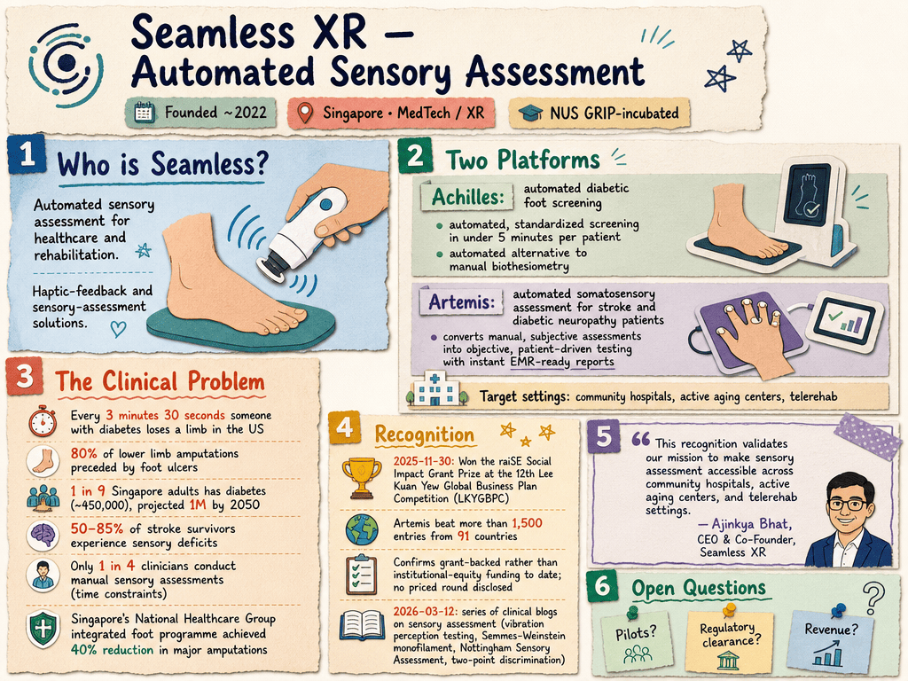

# seamless — LIVING BRIEF
_Last updated: 2026-10-14 22:00 UTC_

## Thesis
Seamless (Seamless XR) is an NUS GRIP-incubated Singapore deep-tech company that built soft-robotics and pneumatic micro-haptic technology — six patents spanning wearables, haptics and soft actuation — and first aimed it at surgical simulation. Its 2026 pivot away from that market was a commercial, not a technical, failure: customer discovery showed each surgical specialty required significant device modification, making a repeatable product infeasible, so the company rebuilt around Artemis, an automated somatosensory assessment platform whose first prototype took five months. Artemis kept the actuator technology but needed a new intended use, protocol, patient interface, scoring logic, workflow, reporting, quality system, regulatory strategy, manufacturing plan and evidence programme — and the company remains grant-funded with no priced equity round disclosed.

_Last material event: 2025-11-30 — Won the raiSE Social Impact Grant Prize at the 12th Lee Kuan Yew Global Business Plan Competition_

## Profile
- Sector: MedTech / XR
- Region: Singapore
- Founded: ~2022
- Stage / funding: Early stage; no priced equity round disclosed
- Key people: Ajinkya Bhat (CEO & Co-Founder), Jonathan Ambrose (Co-Founder)
- Identifiers: [LinkedIn](https://www.linkedin.com/company/seamless-xr)

## Funding history
_No disclosed funding._

## Recent signals
- **2026-10-07** — KoreaTechDesk profile of Seamless XR's pivot from surgical haptics to Artemis: demand was real but every new hospital customer needed significant device modification, so the company rebuilt the commercial system around one clinician's question — [koreatechdesk.com](https://koreatechdesk.com/seamless-xr-surgical-haptics-deep-tech-scalability)
  - Summary: KoreaTechDesk's profile describes how Seamless XR's surgical-simulation business failed a scalability test rather than a demand test. Companies were hiring for similar capabilities and hospital departments had concrete requirements, but each specialty's anatomy, tissue behaviour, procedure-specific content and haptic requirements forced significant device modification, leaving the company a choice between over-engineering the product until pricing narrowed the buyer pool, or building customisations that pulled it toward a project-based model. The pivot came from a clinician discovery session where an occupational therapist, asked what she would fix with a "magic wand", said she could not reliably tell whether a patient's sensation was recovering; the first Artemis prototype was built within five months, preserving the pneumatic micro-haptic actuator work while shifting the goal from dense, high-fidelity tactile experiences to controlled, localized stimulation for sensory assessment. Bhat told KoreaTechDesk the company had to rebuild almost everything commercial and clinical, including the intended use, protocol, patient interface, scoring logic, automated workflow, reporting, quality system, regulatory strategy, manufacturing plan and evidence programme.
  - People: Dr Ajinkya Bhat (Co-Founder & CEO), Jonathan Ambrose (Co-Founder)
  - Numbers: 6 patents (wearables, haptics, soft actuation); Artemis prototype in 5 months
  - Quote: "The pivot was therefore not from a failed technology to a new technology. It was from a commercially infeasible use case to a scalable one." — Dr Ajinkya Bhat, Co-Founder and CEO, Seamless XR

## Older signals
- **2026-03-12** — Published clinical blog on vibration perception testing for diabetic neuropathy screening, positioning the Achilles platform as an automated alternative to manual biothesiometry — [seamless.sg](https://www.seamless.sg/blog/vibration-perception-testing-in-diabetic-neuropathy-screening)
  - Summary: The blog posts comprehensively cover sensory assessment techniques. An article on diabetic foot screening highlights that every 3 minutes 30 seconds someone with diabetes loses a limb in the US, and positions Seamless XR's Achilles platform as delivering automated, standardized screening in under 5 minutes per patient.
  - Numbers: 1 in 9 Singapore adults has diabetes (~450,000), projected 1M by 2050; 80% of lower limb amputations preceded by foot ulcers
- **2026-03-12** — Published clinical blog on somatosensory assessment after stroke, noting 50–85% of stroke survivors experience sensory deficits — [seamless.sg](https://www.seamless.sg/blog/why-somatosensory-assessment-matters-after-stroke)
- **2026-03-12** — Published clinical blog on Semmes-Weinstein monofilament testing protocols and inter-rater reliability — [seamless.sg](https://www.seamless.sg/blog/semmes-weinstein-monofilament-testing)
- **2026-03-12** — Published clinical blog on the Nottingham Sensory Assessment for stroke rehabilitation — [seamless.sg](https://www.seamless.sg/blog/the-nottingham-sensory-assessment)
- **2026-03-12** — Published blog on how Artemis platform addresses gaps in sensory rehabilitation — [seamless.sg](https://www.seamless.sg/blog/how-artemis-can-fix-the-gaps-in-sensory-rehabilitation)
- **2026-03-12** — Published clinical blog on two-point discrimination testing standards and normative data — [seamless.sg](https://www.seamless.sg/blog/two-point-discrimination-testing-standards-normative-data-and-clinical-applications)
- **2026-03-12** — Published blog on the problem of under-screened diabetics leading to preventable amputations, promoting Seamless's Achilles platform — [seamless.sg](https://www.seamless.sg/blog/diabetics-are-not-being-screened-enough-and-it-s-leading-to-amputations)
  - Summary: Corroborates the screening-gap narrative; Singapore's National Healthcare Group integrated foot programme achieved 40% reduction in major amputations.
- **2026-03-12** — Published blog reviewing current sensory rehabilitation methods and their limitations, advocating for technology-assisted alternatives — [seamless.sg](https://www.seamless.sg/blog/sensory-rehabilitation-is-necessary-but-here-s-the-problem)
- **2025-11-30** — Won the raiSE Social Impact Grant Prize at the 12th Lee Kuan Yew Global Business Plan Competition (LKYGBPC) for its Artemis automated somatosensory assessment platform, among 1,500+ entries from 91 countries — [seamless.sg](https://www.seamless.sg/news/seamless-xr-wins-raise-social-impact-grant-prize)
  - Summary: Seamless XR was awarded the raiSE Social Impact Grant Prize at the 12th LKYGBPC, offered in partnership with raiSE to recognise social enterprises using technology to address pressing social needs in Singapore. Its Artemis platform beat more than 1,500 entries from 91 countries with an automated somatosensory assessment system for stroke and diabetic neuropathy patients, converting manual, subjective assessments — which only 1 in 4 clinicians conduct due to time constraints — into objective, patient-driven testing with instant EMR-ready reports. The prize confirms grant-backed rather than institutional-equity funding to date: no priced round is disclosed.
  - People: Ajinkya Bhat (CEO & Co-Founder)
  - Counterparties: raiSE (grant-prize partner), LKYGBPC (competition organiser)
  - Numbers: 1,500+ entries; 91 countries; 1 in 4 clinicians performing manual sensory assessments
  - Quote: "This recognition validates our mission to make sensory assessment accessible across community hospitals, active aging centers, and telerehab settings." — Ajinkya Bhat, CEO and Co-Founder, Seamless XR

## Open questions
- What is the commercial status of Artemis — pilot deployments, regulatory clearance, or paying customers — and what regulatory pathway applies in Singapore?
- Is the Achilles diabetic-foot-screening product still being pursued alongside Artemis, or has the product line consolidated?
- Was the surgical-simulation business wound down entirely, and did the pivot cost any hospital partnerships?
