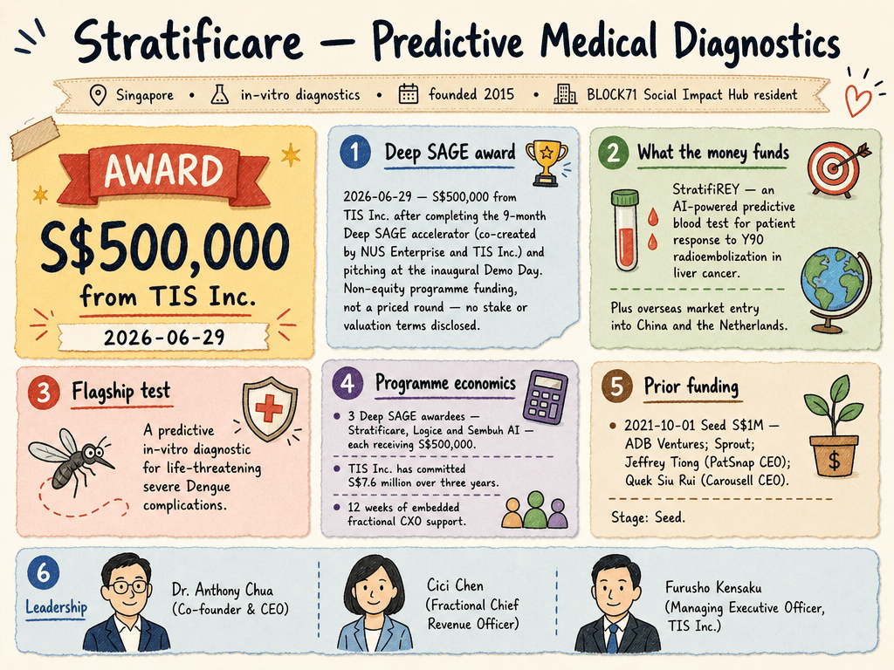

# Stratificare — LIVING BRIEF
_Last updated: 2026-11-03 22:45 UTC_

## Thesis
Stratificare is a Singapore predictive medical-diagnostics startup (launched 2015, BLOCK71 Social Impact Hub resident) building in-vitro diagnostic tests — a flagship predictive test for life-threatening severe Dengue complications, plus a pipeline for liver-cancer treatment response (StratifiREY) and other oncology indications. In June 2026 it raised S$500,000 from TIS Inc. after the Deep SAGE accelerator demo day, funds earmarked for StratifiREY clinical work and overseas market entry into China and the Netherlands. The company frames the next phase as pushing its clinical trials forward and generating its first recurring revenue.

_Last material event: 2026-06-29 — S$500,000 Deep SAGE programme award from TIS Inc. (non-equity)_

## Profile
- Sector: Biotechnology / MedTech
- Region: Singapore
- Founded: 2015
- Stage / funding: Seed
- Key people: Dr. Anthony Chua (Co-founder & CEO)

## Funding history
- **2021-10-01** — Seed, S$1M — ADB Ventures; Sprout, Jeffrey Tiong (PatSnap CEO), Quek Siu Rui (Carousell CEO) — [1covidnews.com](https://1covidnews.com/2021/10/08/stratificare-attracts-seed-funding-from-adb-ventures-sprout-for-its-dengue-disease-prediction-test/)

_Total disclosed: $0.7M._

## Recent signals
- **2026-11-03** — Reached the grand final of the 2026 UAiTED Innovation Competition in Taipei without taking the top award, and used the trip to pitch Taiwanese hospitals on bringing its tests to Taiwan — [stratificare.com](https://www.stratificare.com/post/stratificare-reaches-the-grand-final-of-the-2026-uaited-innovation-competition)
  - Summary: StratifiCare said it was selected as a grand finalist at the 2026 UAiTED Innovation Competition, held 20 October 2026 at the Grand Mayfull Hotel in Taipei, and did not win; the company frames the finals as exposure, feedback and connections within Asia's innovation community. It says the team used the Taipei visit to engage top-tier hospitals with the aim of bringing StratifiCare to Taiwan's healthcare community, alongside five other finalist teams. No hospital partners, trial sites, regulatory steps or commercial terms are disclosed, and the post carries no product or funding news.
  - Counterparties: UAiTED (competition organiser), Taoyuan Andong Startup Hub (host)
  - Numbers: final held 2026-10-20; 6 finalist teams; no award won

## Older signals
- **2026-09-30** — StratifiCare showcased its precision-diagnostics pipeline at the A5X Global Innovation & Venture Summit startup showcase on 24 September, courting global investors — [stratificare.com](https://www.stratificare.com/post/showcasing-our-vision-at-the-a5x-global-innovation-venture-summit-2026)
  - Summary: StratifiCare joined the startup showcase at the A5X Global Innovation & Venture Summit on 24 September 2026, presenting its precision-diagnostics pipeline to an audience of global innovators, investors and industry leaders. The company said it engaged with Heng Swee Keat, the former Deputy Prime Minister of Singapore.
  - People: Heng Swee Keat (former Deputy Prime Minister of Singapore)
- **2026-06-29** — S$500,000 award from TIS Inc. after its Deep SAGE demo-day pitch, earmarked for the StratifiREY liver-cancer blood test — [stratificare.com](https://www.stratificare.com/post/stratificare-secures-s-500-000-investment-from-tis-inc-to-advance-precision-diagnostics) (Also reported by: [en.prnasia.com](https://en.prnasia.com/releases/apac/deep-sage-plugs-execution-gap-as-global-deep-tech-start-ups-demonstrate-scalable-growth-at-inaugural-demo-day-527058.shtml), [prnewswire.com](https://prnewswire.com/apac/news-releases/deep-sage-plugs-execution-gap-as-global-deep-tech-start-ups-demonstrate-scalable-growth-at-inaugural-demo-day-302727036.html))
  - Summary: StratifiCare received S$500,000 from TIS Inc. after completing the 9-month Deep SAGE accelerator (co-created by NUS Enterprise and TIS Inc.) and pitching at the inaugural Deep SAGE Demo Day. The funds are dedicated to StratifiREY, its AI-powered predictive blood test for patient response to Y90 radioembolization in liver cancer. The accelerator's fractional-C-suite support helped the company accelerate entry into overseas markets including China and the Netherlands. NUS Enterprise's PR Newswire release — dated 27 March 2026, earlier than the company's own June post — confirms the S$500,000 is programme funding under Deep SAGE, not a priced equity round: StratifiCare was one of three top startups at the debut Demo Day, alongside Logice and Sembuh AI, each receiving S$500,000 from TIS Inc. with no stake or valuation terms disclosed. TIS Inc. has committed S$7.6 million over three years, investing a minimum of S$500,000 per selected startup, and NUS Enterprise delivers the programme through BLOCK71 (11 cities), including a six-month incubation at BLOCK71 Singapore.
  - People: Dr. Anthony Chua (Co-founder & CEO), Cici Chen (Fractional Chief Revenue Officer), Chern Chet Yong (Mentor), Furusho Kensaku (Managing Executive Officer, TIS Inc.)
  - Counterparties: TIS Inc. (funder), NUS Enterprise (accelerator co-creator, via BLOCK71)
  - Numbers: S$500,000 award; 3 Deep SAGE awardees; TIS Inc. commitment of S$7.6M over three years; 9-month accelerator; 12 weeks of embedded fractional CXO support
  - Quote: "This award is a huge validation of our efforts, and we will continue pushing ahead with our clinical trials, overseas market entry, and generating our first recurring revenue." — Dr. Anthony Chua, Co-founder & CEO

## Open questions
- What is the regulatory/clinical-trial timeline for StratifiREY, and in which jurisdiction would it first seek approval?
- When does the company expect its first recurring revenue, and from which market (China vs. Netherlands vs. Singapore)?
- Does the Taipei hospital outreach turn into a named Taiwan partner or trial, and would Taiwan displace China or the Netherlands as the first commercial market?
